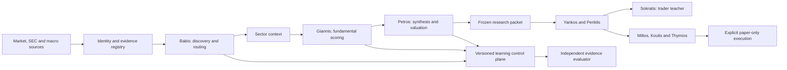
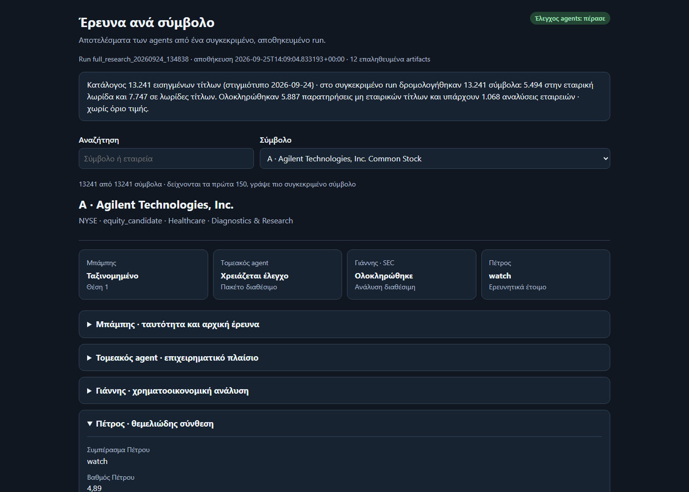
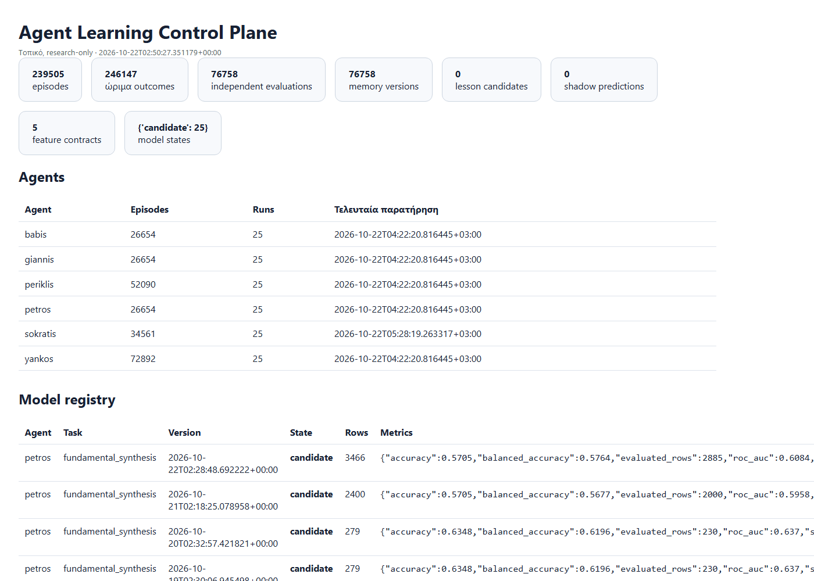

# US Equity Research Ecosystem

Local, evidence-first research for the complete US-listed symbol catalog. The project collects market and filing data, routes each instrument to the correct research lane, coordinates specialized agents and preserves the evidence behind every conclusion.

> **Research only.** The default and full-universe workflows cannot submit orders. Paper execution is a separate, explicit workflow. This project is not financial advice and does not claim proven investment performance.

**For visitors.** This is a personal research project run on one Windows machine: a team of deterministic agents
(no hosted AI model; a local Ollama model only extracts candidate evidence for human review) studies every US-listed
company each night, and a separate paper-trading workflow (Alpaca paper account, no real money) tests the ideas.
Everything the system learns - from paper trades, shadow trades, five-year labs and company results - stays a
*candidate* until the owner promotes it by hand. Paper results and backtests here are evidence for that learning,
not a promise of returns. Credentials live in a local `.env` that is never committed (template: `.env.example`).

## Current verified state

The latest completed full run, `full_research_20260924_134838`, produced:

| Measure | Result |
| --- | ---: |
| US-listed symbols cataloged and processed | 13,241 |
| Company fundamental route | 5,494 |
| Instrument observation routes | 7,747 |
| Saved company analyses | 1,068 |
| Fundamental evaluations completed/reused | 898 |
| Explicitly blocked by evidence/readiness gates | 170 |
| Stage-1 technical errors | 0 |
| Agent artifact audit | Pass |

The receipt is `review_required` because the system exposes missing evidence and coverage gaps instead of converting them into false certainty.

## Architecture



Every packet carries run identity, timestamps, source lineage and explicit unknown fields. A missing value remains unknown; it is never silently treated as zero. Run artifacts are hashed and captured in immutable manifests.

## Agents

| Agent | Responsibility |
| --- | --- |
| Babis | Full-market discovery, instrument classification and research routing |
| Giannis | Deterministic fundamental scoring, evidence gaps and risk labels |
| Petros | Fundamental synthesis, expectations and deterministic valuation |
| Yankos | Short-horizon strategy playbooks |
| Periklis | Swing strategy playbooks |
| Sokratis | Teaching and evaluating the trader agents only |
| Miltos | Entry-trigger observation for already approved paper candidates |
| Koulis | Portfolio exposure and order-intent risk gate |
| Thymios | Final validation of approved paper intents |

The independent fundamental evaluator covers Babis, Giannis and Petros. It does not change their decisions and does not change Sokratis's role.

All nine agents and twelve sector sub-agents also carry a versioned [professional personality and observable reasoning protocol](docs/PERSONALITY_SYSTEM.md). Their observation order, skepticism, revision triggers and handoff style are distinct and practically stress-tested. Personality never changes evidence, scoring, risk limits, authority or execution eligibility.

## Learning without uncontrolled self-modification

The local learning control plane stores immutable decision episodes, delayed market outcomes, independent rubric evaluations and versioned memories. Repeated gaps may create a **candidate lesson**, but candidates cannot change active scores or policies. Models use the manual path:

```text
candidate -> shadow -> champion
```

Model files are JSON-only, promotion is manual and every state transition is auditable. See [Agent learning architecture](docs/AGENT_LEARNING_ARCHITECTURE.md).

## Getting started

### What you need

| | |
| --- | --- |
| Computer | Windows 10/11 with PowerShell (the launchers are PowerShell scripts) |
| Python | **3.12** from [python.org](https://www.python.org/downloads/) (3.11 and 3.13 are not supported) |
| Disk | about 10 GB to start; every nightly run is archived, so plan for more over time (about 35 GB after a month here) |
| Time | installation: a few minutes; **the first full research run takes about 4 hours** (it studies every US-listed symbol, within the providers' free rate limits) |

### Keys (in your local `.env`, never committed)

| Key | Needed for | Cost |
| --- | --- | --- |
| `SEC_USER_AGENT` | **required**: the SEC asks every program to identify itself, e.g. `Your Name your@email.com` | free |
| `FRED_API_KEY` | the macro environment (rates, inflation) | free |
| `ALPACA_API_KEY_ID`, `ALPACA_API_SECRET_KEY` | only the separate paper-trading workflow (a paper account, no real money) and pre-market prices | free paper account |
| `FMP_API_KEY`, `POLYGON_API_KEY` | optional extra sources; the system works without them and reports what is missing | free tiers |

A local [Ollama](https://ollama.com/) model is optional: it only extracts candidate evidence from filings for human review.

### Install and check

```powershell
git clone https://github.com/piranxas2101-prog/us-equity-research-ecosystem-public.git
Set-Location .\us-equity-research-ecosystem-public
.\setup_windows.ps1
```

`setup_windows.ps1` creates the isolated Python 3.12 runtime (`.venv-next`), installs the locked, hash-checked
dependencies, creates `.env` from `.env.example`, initializes the local databases and runs a few smoke tests. Then
open `.env` and add your keys.

A quick check that everything works, before the long run (about a minute, no network):

```powershell
.\.venv-next\Scripts\python.exe -m unittest discover -s tests -p "test_*.py"
.\.venv-next\Scripts\python.exe daily_pipeline.py plan --full-market   # shows every step of a run, runs nothing
```

### First research run

```powershell
.\start_full_research_with_notify.ps1      # research only, in the background; a Windows notification at the end
```

It cannot submit orders. When it ends, build the local dashboards (static HTML files, no server):

```powershell
.\build_demo.ps1                            # then open output\dashboards\index.html
```

### What you will see

Each company's research, agent by agent (identity and routing, sector context, fundamental analysis, synthesis):



What the agents learned and which models are still candidates (nothing is promoted without a human):



The interface is in Greek for now; the code, the documentation and the reports' structure are in English. Daily
reports land under `output/` (research summary, results per period, results journal, labs), and the optional
paper-trading workflow (`SETUP.md`, "Trader Workflow") adds its own session and learning reports.

## Repository guide

| Path | Contents |
| --- | --- |
| [SETUP.md](SETUP.md) | Installation, credentials and first run |
| [PIPELINE_OVERVIEW.md](PIPELINE_OVERVIEW.md) | Agent flow and operating boundaries |
| [ADVANCED_USAGE.md](ADVANCED_USAGE.md) | Optional workflows and detailed commands |
| [docs/](docs/README.md) | Architecture, security and design documentation |
| [research_registry/](research_registry/README.md) | Issuer identity and taxonomy registry |
| [strategy_library/](strategy_library/README.md) | Trader playbooks and validation notes |
| [tests/](tests) | Deterministic unit and contract tests |

Technical strategies pass through a separate [point-in-time research lab](docs/TECHNICAL_RESEARCH_LAB.md) that audits indicator causality and models next-bar fills, costs, drawdown, MFE/MAE, regimes and walk-forward windows before any paper-candidate review.

Generated runtime state belongs under `data/`, `cache/`, `logs/`, `models/` and `output/`; these paths are not source code and are excluded from commits.

## Data providers

The ecosystem can use SEC EDGAR, Alpaca, Massive/Polygon, FMP, FRED, Nasdaq Trader and Yahoo Finance according to the configured route and available credentials. Provider failures, quotas and unsupported instruments remain visible in receipts and evidence-gap reports.

## Security and contribution

- Read [Security and OpenClaw readiness](docs/SECURITY_AND_OPENCLAW_READINESS.md).
- Report security issues using [SECURITY.md](SECURITY.md).
- Development and review rules are in [CONTRIBUTING.md](CONTRIBUTING.md).
- Source code and project documentation are available under the [MIT License](LICENSE).
- Optional project support is described in [DONATIONS.md](DONATIONS.md); no payment link is active.
