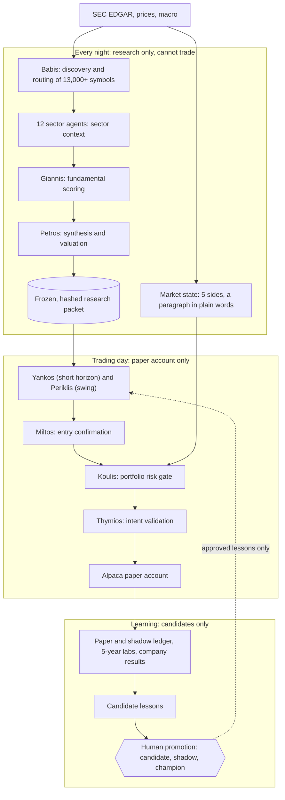
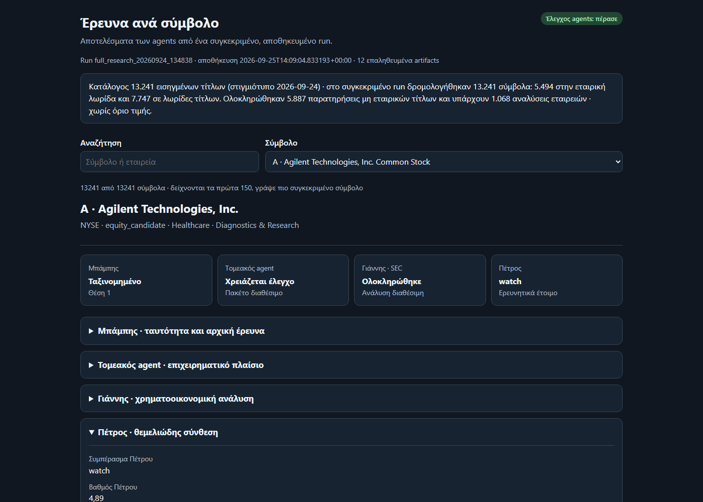
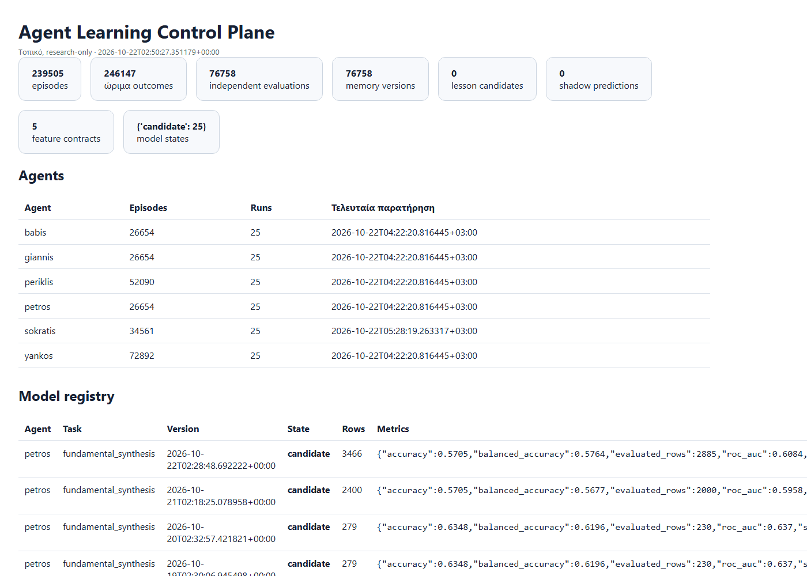

# US Equity Research Ecosystem

[](https://github.com/piranxas2101-prog/us-equity-research-ecosystem-public/actions/workflows/ci.yml)

[](LICENSE)


**A team of named, deterministic agents that studies every US-listed stock each night on one Windows PC, explains
the state of the market in plain words, and tests its ideas with paper trades. Nothing it learns changes its behavior
until a human approves it.**

> **Research only. Not financial advice.** The default and full-universe workflows cannot submit orders. Paper
> trading (Alpaca paper account, no real money) is a separate, explicit workflow. The paper results below are
> currently *negative* and are shown because they are the evidence the system learns from.

## Why it might interest you

- **Evidence first, and unknown stays unknown.** A missing value is never quietly turned into zero or a default.
  Every gap is reported, and a run ends with `review_required` instead of false certainty.
- **A pipeline of agents with clear jobs.** Each agent has one responsibility and a handoff contract. Research
  packets are frozen and hashed before the traders see them.
- **No hosted LLMs.** Scoring, valuation and risk decisions are deterministic code. A local Ollama model may only
  extract *candidate* evidence from filings, with quotes verified, for a human to review.
- **Learning with a human in the loop.** Paper trades, shadow trades, five-year labs and company results all feed
  learning. Every lesson goes candidate → shadow → champion, and promotion is always manual.
- **It reads the market, not just stocks.** Each night it describes the market on five sides: trend, mood,
  participation, risk appetite and what the market rewards. It checks which strategies and sectors historically
  worked in such a market, using a month-block bootstrap, the Benjamini-Hochberg correction and years with the
  same sign. The risk gate then keeps out the proposals the market stands against.
- **Statistics before rules.** Strategies, exits, holding horizons, fundamental rules and results-season behavior
  each have a point-in-time lab (about 1.9 million five-year strategy signals) before any rule may change.

### What it says about the market each night

The report opens with a paragraph like this one (written in Greek, the owner's language; translated here, from
the night of 2026-11-03):

> The market (SPY) is falling: +3.4% from its 200-day average, −2.0% over 3 months. The mood is calm (20-day
> volatility 11%, 60-day 10%). Participation is narrow: 37% of stocks are above their 50-day average, with 76 new
> yearly highs and 355 new lows. The market wants risk: small companies +2.6% and technology −6.6% against SPY over
> 20 days. Last week 45% of stocks rose: the market rewards both longs and shorts. The agents propose 307 longs and
> 73 shorts. Yesterday I read that the market rewards both; today 44% of stocks rose, so the reading was right.
> Sectors in such a market (5 years, against the average stock): materials go ahead (+1.8% in 20 sessions when the
> market falls); real estate (−5.9% in 60 sessions) and consumer staples (−5.1%) fall behind.

## How it works



Every packet carries run identity, timestamps, source lineage and explicit unknown fields. Run artifacts are hashed
and captured in immutable manifests.

## Where it stands (honestly)

| Measure | Latest |
| --- | ---: |
| Symbols cataloged and processed in the nightly run (2026-11-04) | 13,239 |
| Routed to company fundamental research / instrument observation | 5,320 / 7,919 |
| Technical errors / agent artifact audit | 0 / pass |
| Unit and contract tests | 1,000+ |
| Paper trades closed (14 sessions, 2026-10-15 to 2026-11-03) | 194 |
| Average paper result per trade / share of winners | **−1.1% / 33%** |

The paper results are not good yet, and the system's own reports explain much of the loss. Waiting for an entry
confirmation cost about 1.2% per trade. Long-horizon positions were closed after one day. In late October the
agents proposed shorts that the market did not support. Each finding became a lab and a documented rule review
([docs/RULES_REVIEW.md](docs/RULES_REVIEW.md)). Changes go in only with a written rationale and tests.

## Feedback wanted

This is a one-person project and outside eyes help most. Issues and comments are very welcome on:

1. **The market-state reading** ([market_state.py](market_state.py), [lesson](docs/MARKET_STATE_LESSON.md)): are
   the five sides and their thresholds sensible? What would you add?
2. **The statistics** in the labs: block bootstrap, the Benjamini-Hochberg correction, point-in-time handling.
   Where could look-ahead or survivorship bias still leak in?
3. **The architecture**: agents with narrow roles, frozen packets, manual promotion. Is it too much ceremony, or
   just enough?
4. **Getting started**: if setup fails on your machine, please open an issue with the error.

If you find the approach useful, a ⭐ helps others find it.

## Agents

| Agent | Responsibility |
| --- | --- |
| Babis | Full-market discovery, instrument classification and research routing |
| Giannis | Deterministic fundamental scoring, evidence gaps and risk labels |
| Petros | Fundamental synthesis, expectations and deterministic valuation |
| Yankos | Short-horizon strategy playbooks |
| Periklis | Swing strategy playbooks |
| Sokratis | Teaching and evaluating the trader agents only |
| Miltos | Entry-trigger observation for already approved paper candidates |
| Koulis | Portfolio exposure and order-intent risk gate |
| Thymios | Final validation of approved paper intents |

The independent fundamental evaluator covers Babis, Giannis and Petros. It does not change their decisions and does not change Sokratis's role.

All nine agents and twelve sector sub-agents also carry a versioned [professional personality and observable reasoning protocol](docs/PERSONALITY_SYSTEM.md). Their observation order, skepticism, revision triggers and handoff style are distinct and practically stress-tested. Personality never changes evidence, scoring, risk limits, authority or execution eligibility.

## Learning without uncontrolled self-modification

The local learning control plane stores immutable decision episodes, delayed market outcomes, independent rubric evaluations and versioned memories. Repeated gaps may create a **candidate lesson**, but candidates cannot change active scores or policies. Models use the manual path:

```text
candidate -> shadow -> champion
```

Model files are JSON-only, promotion is manual and every state transition is auditable. See [Agent learning architecture](docs/AGENT_LEARNING_ARCHITECTURE.md).

## Getting started

### What you need

| | |
| --- | --- |
| Computer | Windows 10/11 with PowerShell (the launchers are PowerShell scripts) |
| Python | **3.12** from [python.org](https://www.python.org/downloads/) (3.11 and 3.13 are not supported) |
| Disk | about 10 GB to start; every nightly run is archived, so plan for more over time (about 35 GB after a month here) |
| Time | installation: a few minutes; **the first full research run takes about 4 hours** (it studies every US-listed symbol, within the providers' free rate limits) |

### Keys (in your local `.env`, never committed)

| Key | Needed for | Cost |
| --- | --- | --- |
| `SEC_USER_AGENT` | **required**: the SEC asks every program to identify itself, e.g. `Your Name your@email.com` | free |
| `FRED_API_KEY` | the macro environment (rates, inflation) | free |
| `ALPACA_API_KEY_ID`, `ALPACA_API_SECRET_KEY` | only the separate paper-trading workflow (a paper account, no real money) and pre-market prices | free paper account |
| `FMP_API_KEY`, `POLYGON_API_KEY` | optional extra sources; the system works without them and reports what is missing | free tiers |

A local [Ollama](https://ollama.com/) model is optional: it only extracts candidate evidence from filings for human review.

### Install and check

```powershell
git clone https://github.com/piranxas2101-prog/us-equity-research-ecosystem-public.git
Set-Location .\us-equity-research-ecosystem-public
.\setup_windows.ps1
```

`setup_windows.ps1` creates the isolated Python 3.12 runtime (`.venv-next`), installs the locked, hash-checked
dependencies, creates `.env` from `.env.example`, initializes the local databases and runs a few smoke tests. Then
open `.env` and add your keys.

A quick check that everything works, before the long run (about a minute, no network):

```powershell
.\.venv-next\Scripts\python.exe -m unittest discover -s tests -p "test_*.py"
.\.venv-next\Scripts\python.exe daily_pipeline.py plan --full-market   # shows every step of a run, runs nothing
```

### First research run

```powershell
.\start_full_research_with_notify.ps1      # research only, in the background; a Windows notification at the end
```

It cannot submit orders. When it ends, build the local dashboards (static HTML files, no server):

```powershell
.\build_demo.ps1                            # then open output\dashboards\index.html
```

### What you will see

Each company's research, agent by agent (identity and routing, sector context, fundamental analysis, synthesis):



What the agents learned and which models are still candidates (nothing is promoted without a human):



The interface is in Greek for now; the code, the documentation and the reports' structure are in English. Daily
reports land under `output/` (research summary, results per period, results journal, labs), and the optional
paper-trading workflow (`SETUP.md`, "Trader Workflow") adds its own session and learning reports.

## Repository guide

| Path | Contents |
| --- | --- |
| [SETUP.md](SETUP.md) | Installation, credentials and first run |
| [PIPELINE_OVERVIEW.md](PIPELINE_OVERVIEW.md) | Agent flow and operating boundaries |
| [ADVANCED_USAGE.md](ADVANCED_USAGE.md) | Optional workflows and detailed commands |
| [docs/](docs/README.md) | Architecture, security and design documentation |
| [research_registry/](research_registry/README.md) | Issuer identity and taxonomy registry |
| [strategy_library/](strategy_library/README.md) | Trader playbooks and validation notes |
| [tests/](tests) | Deterministic unit and contract tests |

Technical strategies pass through a separate [point-in-time research lab](docs/TECHNICAL_RESEARCH_LAB.md) that audits indicator causality and models next-bar fills, costs, drawdown, MFE/MAE, regimes and walk-forward windows before any paper-candidate review.

Generated runtime state belongs under `data/`, `cache/`, `logs/`, `models/` and `output/`; these paths are not source code and are excluded from commits.

## Data providers

The ecosystem can use SEC EDGAR, Alpaca, Massive/Polygon, FMP, FRED, Nasdaq Trader and Yahoo Finance according to the configured route and available credentials. Provider failures, quotas and unsupported instruments remain visible in receipts and evidence-gap reports.

## Security and contribution

- Read [Security and OpenClaw readiness](docs/SECURITY_AND_OPENCLAW_READINESS.md).
- Report security issues using [SECURITY.md](SECURITY.md).
- Development and review rules are in [CONTRIBUTING.md](CONTRIBUTING.md).
- Source code and project documentation are available under the [MIT License](LICENSE).
- Optional project support is described in [DONATIONS.md](DONATIONS.md); no payment link is active.
